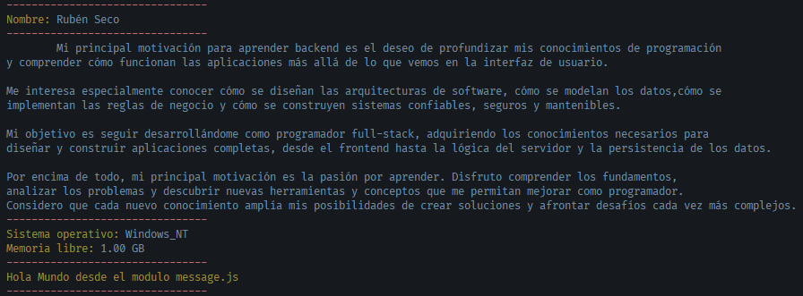

# Diplomatura en Profesional Full-Stack Developer

## Curso de desarrollo con Node JS - Profesor: Gabriel Alberini

### Módulo 1: Node JS

### Unidad 1: Introducción a Node JS

### Tarea 1: Mi primer _script_ en Node JS

### Objetivos:

Instalar y configurar Node JS.

Comprender la ejecución de código JavaScript fuera del navegador y aplicar el uso básico de módulos nativos.

### Capturas de pantallas:



### Pasos para la ejecución local:

1. Clonar el repositorio:

```bash
git clone https://github.com/Diplomatura-Full-Stack-Developer/Node-M1-T1
```

2. Instalar las dependencias:

```bash
npm install
```

3. Ejecutar el script:

```bash
node app.js
```

### Recursos utilizados:

- Node JS - Versión 24.20.0 ([https://nodejs.org/es/download/](https://nodejs.org/es/download/))
- Npm - Versión 12.0.2 (instalado por defecto con Node JS)
- Chalk - Versión 6.0.1 ([https://www.npmjs.com/package/chalk](https://www.npmjs.com/package/chalk))

### Alumno: Rubén Seco

### Comisión: 181806
